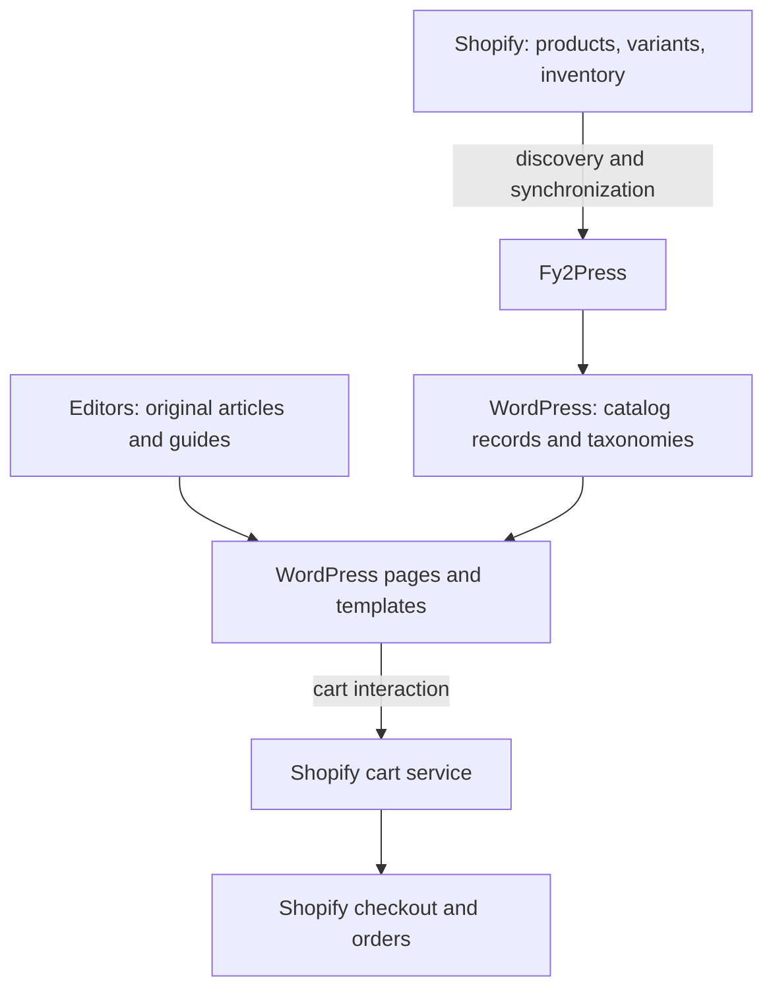
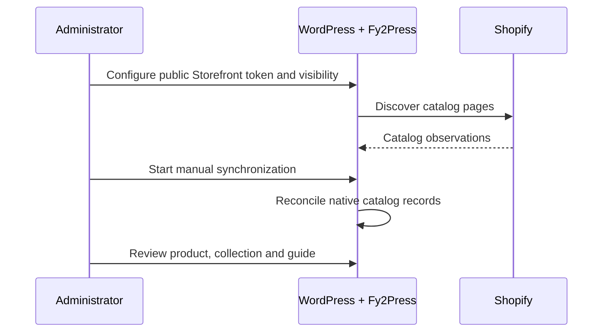

# Architecture: one catalog, two publishing surfaces

[Français canadien](../fr-ca/docs/architecture.md) · [Start here](../README.md)

Use this architecture when WordPress already carries valuable editorial content and Shopify manages the commercial catalog. Fy2Press connects those responsibilities without requiring WooCommerce or creating a second checkout.

## Assign responsibilities

Text alternative: Shopify manages commercial records. Fy2Press reads the catalog and writes WordPress publishing records. Editors compose pages around those records. Cart operations and checkout belong to Shopify. Arrows describe responsibilities, not proof of a connected test.

## Configure, synchronize and publish

Text alternative: configure the connection and publishing choices, discover the catalog, run synchronization, then review the resulting pages. New product records are published directly by the observed sync code; prepare visibility on staging first.

## Browse and buy

A visitor reads a WordPress page. A grid can use saved catalog values, while some product components can request Shopify through a cache. Cart actions use Shopify services. Final checkout and orders stay with Shopify. A local product page does not guarantee offline commerce or current stock.

## Worked choice

A brand keeps its WordPress magazine and Shopify store. It creates a WordPress collection page with an introduction, places the products loop below it, and writes an original buying guide linking to selected products. The editor owns the guide; the merchant owns prices and inventory. The agency verifies the intended URL and rendered metadata for each page family.

Counterexample: removing the Shopify subscription after importing a catalog. Catalog records do not replace Shopify. If the project needs only one purchase button, compare that simpler option before introducing a native catalog.

Next: [scenarios](decision-scenarios.md), [data ownership](data-ownership-and-freshness.md), [connection guide](https://fy2press.com/docs/connect-shopify/).

Basis: [publisher projection](../sources/manifest-projection.json), [package identity](../artefacts/release-reference.json). Diagrams are explanatory designs, not transaction recordings.
