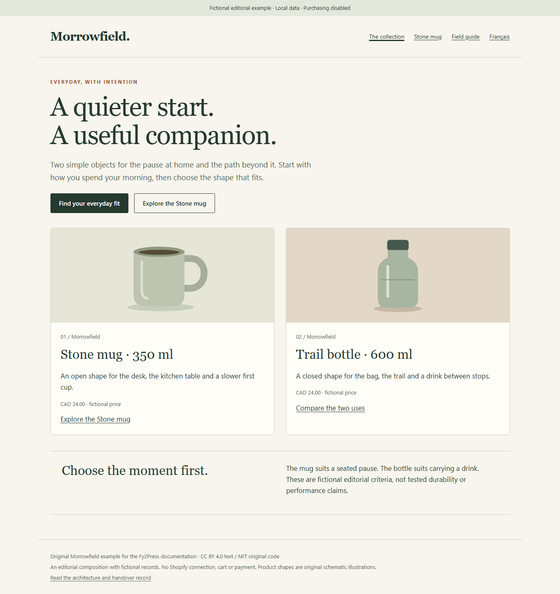
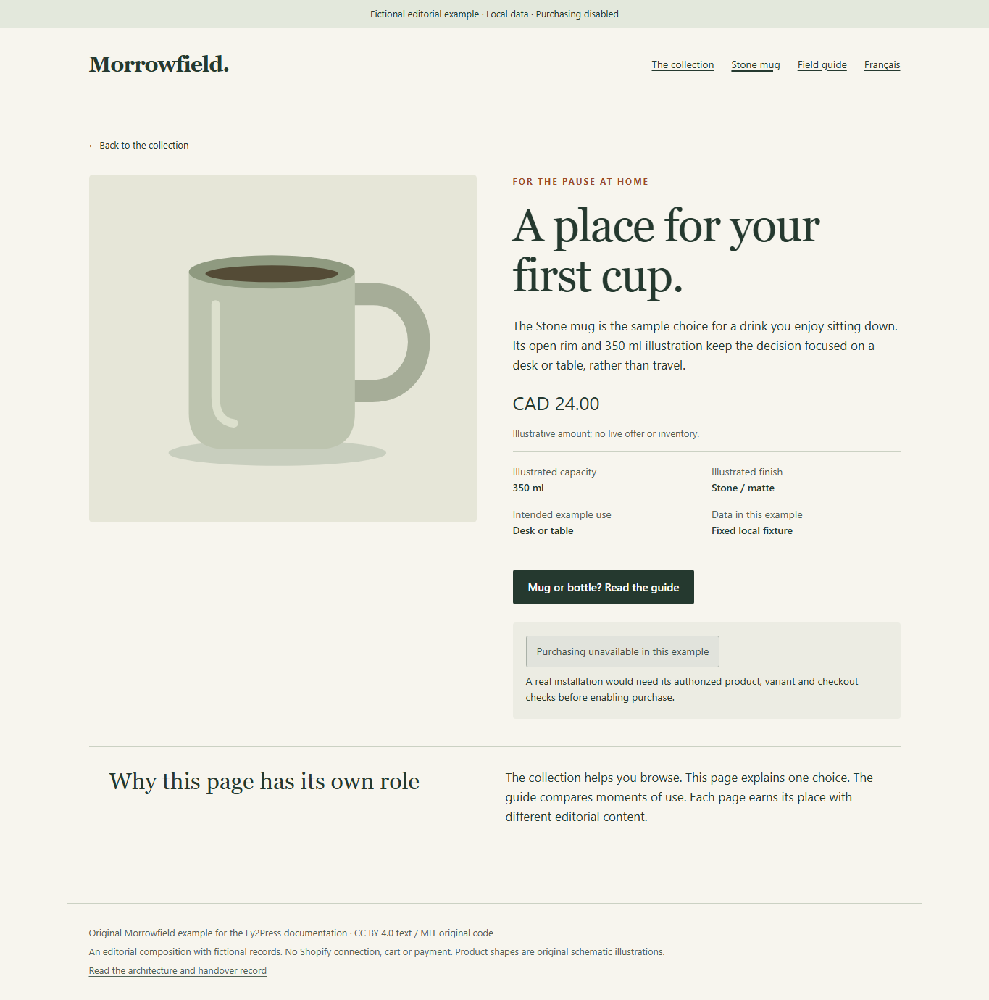
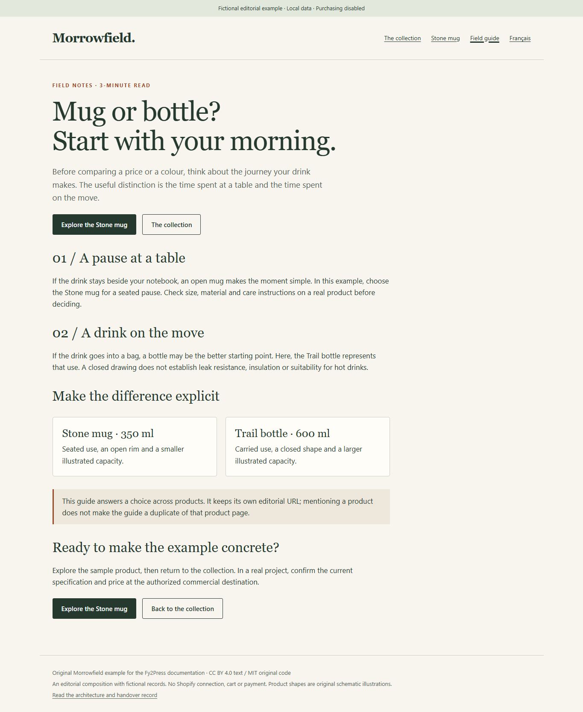

# Morrowfield: a complete collection, product and guide example

[Français canadien](../fr-ca/examples/morrowfield.md) · [Start here](../README.md)

Morrowfield is a fictional two-product editorial project. Its finished local example connects a collection, one product page and an original buying guide. Use it to see how distinct page roles, component choices and a filled handover fit together.

## Open the example

Download [morrowfield.html](morrowfield.html) and open it in a browser. It is self-contained, with original schematic illustrations, English and Canadian French, and no external assets. GitHub shows its source; it does not host this HTML as a live storefront.

Alternatively, from the root of a local copy of this repository:

```powershell
python -m http.server 18547 --bind 127.0.0.1
```

Open `http://127.0.0.1:18547/examples/morrowfield.html`. Follow **The collection → Stone mug → Field guide → The collection**. The language switch keeps the current page. Stop the local server with `Ctrl+C`.

The HTML is a reusable editorial composition, not a WordPress theme, a Fy2Press renderer or an installable plugin. Its local query routes are `?page=collection&lang=en`, `?page=product&lang=en` and `?page=guide&lang=en`; use `lang=fr` for French. Purchasing is visibly disabled.

## The initial need and the finished pages

The fictional publisher needs to explain when a mug or bottle fits a reader’s morning. The catalog contains a Stone mug, illustrated at 350 ml, and a Trail bottle, illustrated at 600 ml. Both use a fixed fictional CAD 24.00 price. No material, stock, delivery or performance claim is inferred from the drawings.

| Page | Finished content and primary action |
| --- | --- |
| Collection | An original introduction, two illustrated cards and a choice of reading the guide or exploring the Stone mug. The bottle card links to the comparison; a second product detail is outside this three-page example. |
| Product | A Stone mug use case, explicit sample specifications and price, a disabled purchase area, and a link to the buying guide. |
| Guide | Two situations of use, a comparison, cautions about unverified product properties, and links to the collection and sample product. |

### Collection



### Product



### Guide



## Component map for a WordPress implementation

| Role | Component or content to use | Required context |
| --- | --- | --- |
| Collection introduction | Normal WordPress heading, paragraph and links | An ordinary editorial page. |
| Product selection | `fy2press_products_loop` | An actual synchronized collection handle; a compatible loop context. |
| Single product | `fy2press_product` | The WordPress product post ID, not a Shopify product or variant ID. |
| Guide and comparison | Normal WordPress content and explicit links | Original editorial prose on its own page. |
| Price and purchase control | The product component’s actual output | Inspect its data source and perform separately authorized commerce checks. |

Example inputs for the real components:

```text
[fy2press_products_loop collection="morrowfield" limit="12" columns="3"]
[fy2press_product id="123"]
```

Replace the handle and ID on your authorized staging site. The HTML’s two-card layout is an editorial design choice, not an assertion that the shortcode above produces identical pixels. See the [component contracts](../developer/README.md) for actual defaults, contexts and recorded callback results.

## Filled architecture decision

This is a worked adaptation of the [blank architecture record](../reusable/architecture-decision.md). Roles below are fictional responsibilities, not named clients or actual approvals.

| Field | Morrowfield decision |
| --- | --- |
| Decision and owner | 2026-10-14; fictional editorial lead, with a technical implementer responsible for staging acceptance. |
| Objectives | Explain two uses, preserve an original guide, and make the path from selection to one product understandable. |
| System roles | Proposed production architecture: Shopify owns commercial product data; WordPress owns editorial pages. This delivered example is standalone HTML with fixed data. |
| Catalog and change frequency | Two illustrative records; no incoming updates. A real merchant must declare its price and stock change frequency before deployment. |
| Languages and builder | English and French editorial views; proposed WordPress native editor. Catalog translation is a separate requirement, not proven by this language switch. |
| Links or one purchase embed | Sufficient if only one purchase destination is needed. Rejected for this worked architecture because the brief also calls for a browsable collection and a dedicated product explanation. |
| FREE | Candidate for a staging implementation using the documented native loop and product shortcode. No premium builder requirement is present. FREE runtime was not loaded by this HTML. |
| PRO | Not selected. This example demonstrates no premium design, builder or scheduling requirement. |
| Another architecture | Reconsider if translated catalog data, multiple stores or a refresh guarantee exceeds the verified product contract. |
| Cost decision | No purchase for the local example. Hosting, Shopify and any future licences require a dated quote; no price is assumed here. |
| Acceptance | Local editorial navigation and visual layout accepted at the scope of the browser record below. WordPress deployment and commercial acceptance remain NOT_RUN. |
| Review trigger | A changed page role, catalog language, builder, refresh requirement or commercial destination. |

## Filled URL and SEO decision

The planned production paths below use the reserved illustrative domain `morrowfield.example`; they are not deployed destinations. This local HTML deliberately has `noindex,nofollow`, no canonical tag and no sitemap. Its query views demonstrate navigation, not production URL behavior.

| Page family | Proposed preference and distinct value | Implementation and verification owner |
| --- | --- | --- |
| Collection | `https://morrowfield.example/collections/everyday/`: selection criteria and product overview. | WordPress implementer inspects the actual collection URL, canonical, robots and sitemap. Do not treat a product-only Fy2Press setting as a collection control. |
| Product | `https://morrowfield.example/products/stone-mug/`: original use-case explanation around commercial data. | SEO owner compares the real WordPress and Shopify product pages before selecting the preferred URL. If they are equivalent, revisit this preference. The Shopify owner must inspect its own canonical output separately. |
| Guide | `https://morrowfield.example/guides/mug-or-bottle/`: an original choice across products, not an equivalent product page. | Editorial owner retains the guide’s own URL; implementer verifies its canonical and indexability. |
| French equivalents | Proposed `/fr-ca/collections/quotidien/`, `/fr-ca/produits/tasse-stone/` and `/fr-ca/guides/tasse-ou-bouteille/`. | Translator and implementer map each equivalent explicitly and check hreflang on the real site. These are original page translations, not a claim of catalog translation support. |

Rejected: canonicalizing the guide to the mug solely because it mentions it; assuming a WordPress setting changes Shopify; indexing local query variants as production pages. Apply [SEO-02, SEO-03 and collection cases](../docs/seo-decision-matrix.md), then complete the [SEO record](../reusable/seo-decision-record.md) from actual page output. Search-engine selection and ranking results: **NOT_RUN**.

## Filled agency handover

| Handover item | Completed example record |
| --- | --- |
| Project identity | Fictional Morrowfield, 2026-10-14. Deliverable: this HTML, two-language case and browser observation. No client acceptance is represented. |
| Installed platform | None. WordPress, theme, SEO extension and builder versions: not applicable to the static deliverable. Target Fy2Press reference: FREE 1.0.0, SVN 3744276; no package installed by this example. |
| Product data owner | Proposed merchant/catalog owner in Shopify. Current values are constants in the example. Never infer stock or a remote checkout price from these cards. |
| Editorial owner | Proposed agency/editorial lead for collection introduction, guide, internal links and translated prose. |
| Refresh operation | No synchronization exists here. Before production, merchant and implementer agree a maximum acceptable age for each datum, measure it in staging and assign manual refresh or authorized scheduling. |
| Acceptance URLs | The six local page/language combinations above. Inspect product, collection and guide after every content or layout edit. |
| Price and variant check | NOT_RUN against Shopify. Confirm the selected variant and current commercial destination before enabling any purchase path. |
| Checkout | NOT_RUN. The button is disabled, and no cart, payment, licence or store credential is requested. |
| Backup and rollback | Keep the versioned source before edits; revert the static deliverable to that version if needed. A production WordPress backup and restore procedure remains to be assigned and tested. |
| Incident handling | Fictional technical maintainer diagnoses broken links or missing content. In a real deployment, merchant owns price/stock discrepancies and supplies a private incident channel; do not add credentials to this record. |
| Open items and due gate | Technical implementer: actual staging, canonical/robots/sitemap/hreflang, measured freshness and authorized checkout evidence **before commercial launch**. No invented deadline or owner sign-off. |

Adapt the [blank handover](../reusable/agency-handover.md) for a real client. The [data ownership and freshness guide](../docs/data-ownership-and-freshness.md) explains why a synchronized record, API cache and page HTML need separate checks.

## Observed results and limits

The [browser observation](morrowfield-observation.json) identifies the exact HTML and screenshot hashes, tested browser, viewports and outcomes. The executed local journey covers the collection, product and guide in both languages, mobile navigation, language preservation, disabled purchasing and absence of external requests. Screenshots above show the desktop views; the observation also records the mobile checks.

This browser observation is separate from the earlier [native WordPress component observation](../sources/developer-observation.json), which used two generic fictional records in an isolated WordPress lab. The Stone/Trail editorial fixture does not replace those records or extend that proof. No connected sync, stock, variant request, checkout, installed theme compatibility or SEO outcome is demonstrated here.

Original text and illustrations may be adapted under [CC BY 4.0; original code under MIT](../LICENSE.md). Suggested attribution: “Adapted from PAGUP, Fy2Press Morrowfield example; changes by [your organization].”
