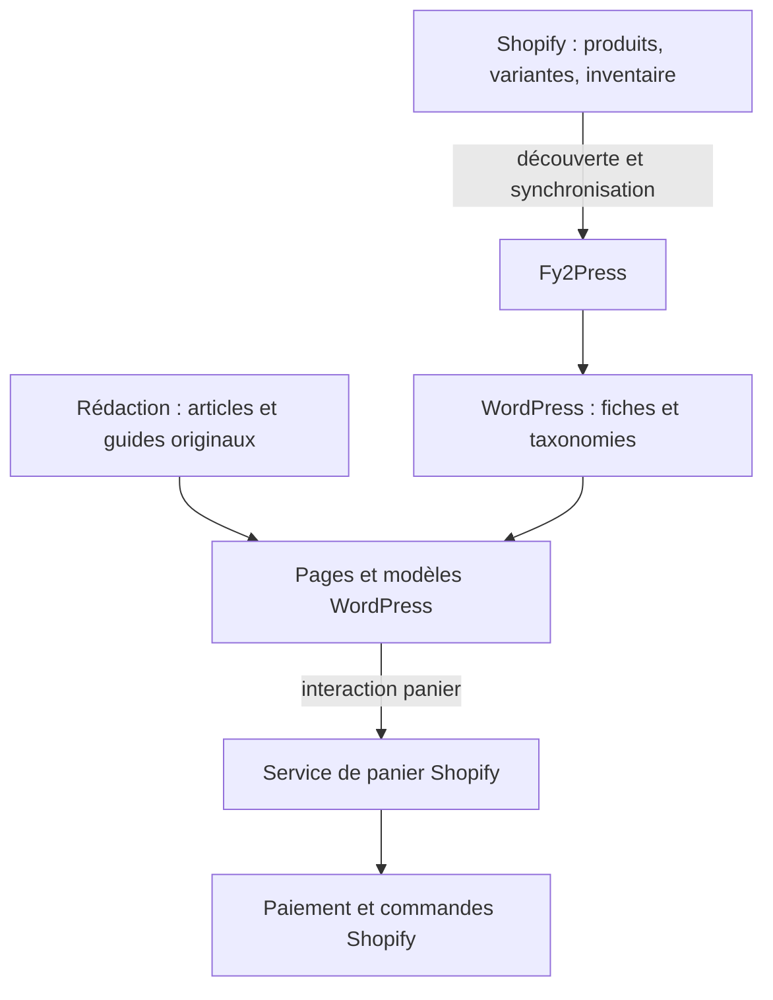
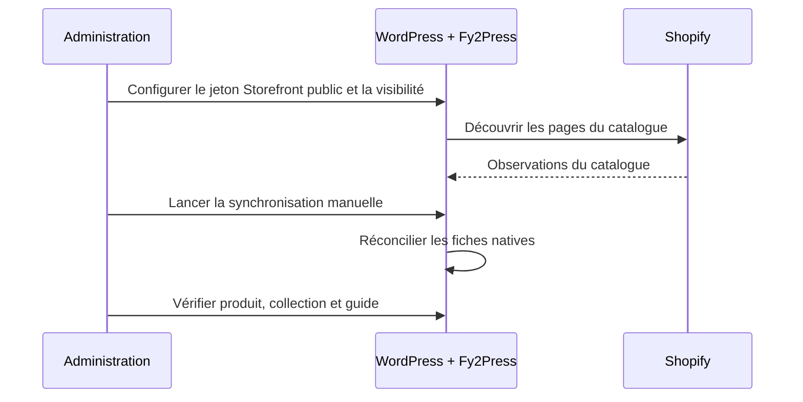

# Architecture : un catalogue, deux surfaces de publication

[English](../../docs/architecture.md) · [Accueil](../README.md)

Cette architecture convient lorsque WordPress porte déjà un contenu éditorial utile et que Shopify gère le catalogue commercial. Fy2Press relie ces responsabilités sans exiger WooCommerce ou créer un second paiement.

## Répartir les responsabilités

Équivalent textuel : Shopify gère les données commerciales. Fy2Press lit le catalogue et écrit des fiches dans WordPress. La rédaction compose les pages autour de ces fiches. Le panier et le paiement appartiennent à Shopify. Les flèches expliquent les responsabilités; elles ne prouvent pas un essai connecté.

## Configurer, synchroniser et publier

Équivalent textuel : configurer la connexion et les choix de publication, découvrir le catalogue, synchroniser, puis relire les pages obtenues. Le code observé publie directement les nouvelles fiches produit; préparer leur visibilité en préproduction.

## Consulter et acheter

Une personne lit une page WordPress. La grille peut utiliser des valeurs sauvegardées; certains composants peuvent interroger Shopify par un cache. Les actions de panier utilisent Shopify. Le paiement final et les commandes restent dans Shopify. Une fiche locale ne garantit ni commerce hors ligne ni inventaire actuel.

## Décision illustrée

Une marque conserve son magazine WordPress et sa boutique Shopify. Elle crée une page de collection avec une introduction et une boucle de produits, puis rédige un guide original qui relie des produits choisis. La rédaction gère le guide; le marchand gère les prix et l’inventaire. L’agence vérifie l’URL souhaitée et les métadonnées rendues pour chaque famille de pages.

Contre-exemple : supprimer l’abonnement Shopify après l’importation du catalogue. Les fiches ne remplacent pas Shopify. Pour un seul bouton d’achat, comparer d’abord cette option plus simple au besoin d’un catalogue natif.

Suite : [scénarios](decision-scenarios.md), [propriété des données](data-ownership-and-freshness.md), [connexion Shopify](https://fy2press.com/fr-ca/docs/connect-shopify/).

Sources : [projection de l’éditeur](../../sources/manifest-projection.json), [identité du paquet](../../artefacts/release-reference.json). Les diagrammes expliquent la conception; ils ne sont pas des enregistrements de transactions.
