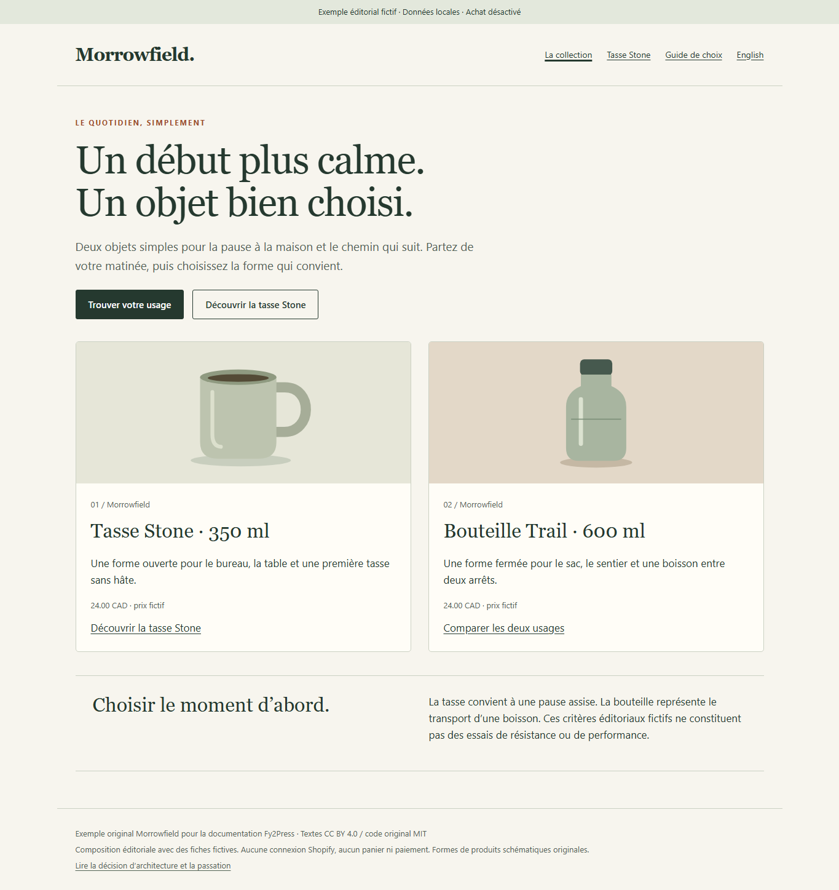
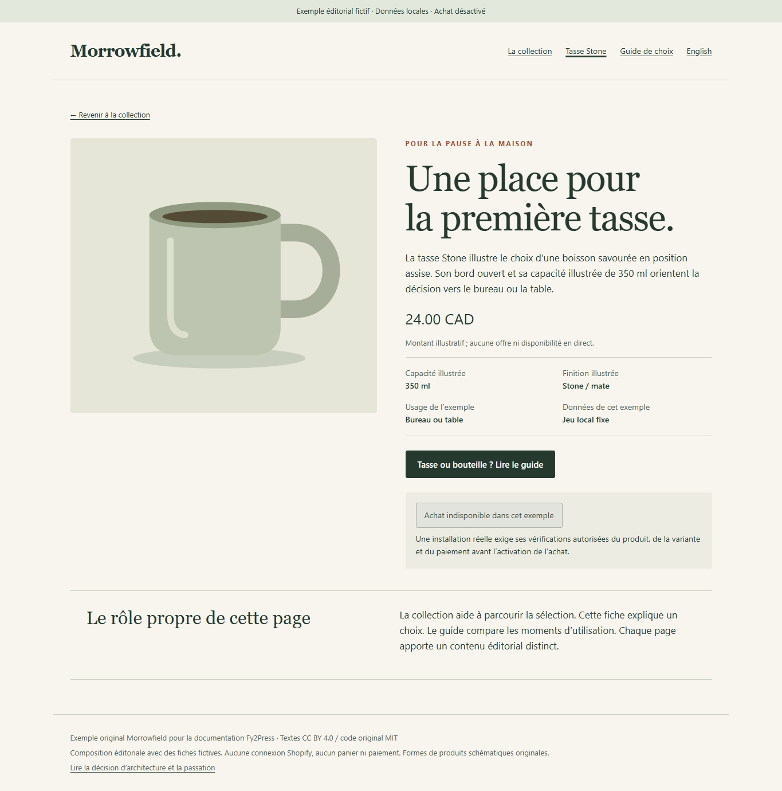
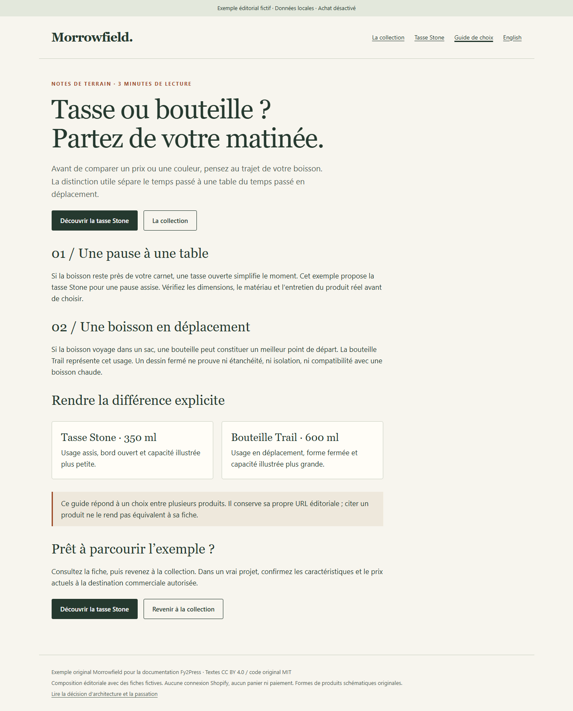

# Morrowfield : un exemple complet de collection, produit et guide

[English](../../examples/morrowfield.md) · [Point de départ](../README.md)

Morrowfield est un projet éditorial fictif de deux produits. Son exemple local terminé relie une collection, une fiche produit et un guide d’achat original. Il montre comment réunir des rôles de pages distincts, des choix de composants et une passation remplie.

## Ouvrir l’exemple

Téléchargez [morrowfield.html](../../examples/morrowfield.html) et ouvrez-le dans un navigateur. Ce fichier autonome contient des illustrations schématiques originales, les versions anglaise et française canadienne, sans ressource externe. GitHub en affiche le code ; il n’héberge pas cette page comme boutique active.

Vous pouvez aussi lancer cette commande à la racine d’une copie locale du dépôt :

```powershell
python -m http.server 18547 --bind 127.0.0.1
```

Ouvrez `http://127.0.0.1:18547/examples/morrowfield.html`, puis choisissez « Français ». Parcourez **La collection → Tasse Stone → Guide de choix → La collection**. Le sélecteur de langue conserve la page courante. Arrêtez le serveur local avec `Ctrl+C`.

Le HTML est une composition éditoriale réutilisable. Il ne constitue ni un thème WordPress, ni un moteur de rendu Fy2Press, ni une extension installable. Ses vues locales sont `?page=collection&lang=fr`, `?page=product&lang=fr` et `?page=guide&lang=fr` ; utilisez `lang=en` pour l’anglais. L’achat est visiblement désactivé.

## Le besoin initial et les pages terminées

L’éditeur fictif veut expliquer quand une tasse ou une bouteille convient à la matinée du lecteur. Le catalogue comprend une tasse Stone illustrée à 350 ml et une bouteille Trail illustrée à 600 ml. Les deux affichent un prix fictif fixe de 24.00 CAD. Les dessins ne prouvent aucun matériau, stock, délai de livraison ou rendement.

| Page | Contenu terminé et action principale |
| --- | --- |
| Collection | Une introduction originale, deux cartes illustrées et le choix de lire le guide ou d’explorer la tasse Stone. La carte bouteille mène à la comparaison ; une deuxième fiche détaillée dépasse ce parcours de trois pages. |
| Produit | Un usage de la tasse Stone, des caractéristiques et un prix explicitement fictifs, une zone d’achat désactivée et un lien vers le guide. |
| Guide | Deux situations d’utilisation, une comparaison, les propriétés produit restant à vérifier et des liens vers la collection et la fiche. |

### Collection



### Produit



### Guide



## Composants pour une réalisation WordPress

| Rôle | Composant ou contenu à utiliser | Contexte requis |
| --- | --- | --- |
| Introduction de collection | Titres, paragraphes et liens WordPress ordinaires | Une page éditoriale ordinaire. |
| Sélection de produits | `fy2press_products_loop` | Un handle de collection réellement synchronisée ; un contexte de boucle compatible. |
| Produit unique | `fy2press_product` | L’ID de la fiche produit WordPress, pas un identifiant produit ou variante Shopify. |
| Guide et comparaison | Contenu WordPress ordinaire et liens explicites | Une prose éditoriale originale sur sa propre page. |
| Prix et contrôle d’achat | Le rendu réel du composant produit | Examiner sa source de données et réaliser les contrôles commerciaux autorisés séparément. |

Exemples d’entrées pour les vrais composants :

```text
[fy2press_products_loop collection="morrowfield" limit="12" columns="3"]
[fy2press_product id="123"]
```

Remplacez le handle et l’ID dans votre préproduction autorisée. La disposition HTML à deux cartes est un choix éditorial ; elle ne prétend pas reproduire à l’identique le rendu du code court ci-dessus. Les [contrats des composants](../developer/README.md) précisent les valeurs par défaut, les contextes et les retours de callbacks observés.

## Décision d’architecture remplie

Il s’agit d’une adaptation du [modèle vierge](../reusable/architecture-decision.md). Les rôles représentent des responsabilités fictives, sans client nommé ni approbation réelle.

| Champ | Décision Morrowfield |
| --- | --- |
| Décision et responsable | 2026-10-14 ; responsable éditorial fictif, avec une personne technique chargée de l’acceptation en préproduction. |
| Objectifs | Expliquer deux usages, préserver un guide original et rendre compréhensible le passage de la sélection à un produit. |
| Rôles des systèmes | Architecture de production proposée : Shopify possède les données commerciales ; WordPress possède les pages éditoriales. L’exemple livré est un HTML autonome à données fixes. |
| Catalogue et fréquence | Deux fiches illustratives ; aucune mise à jour entrante. Le marchand réel devra préciser la fréquence de changement des prix et stocks avant déploiement. |
| Langues et éditeur | Vues éditoriales anglaise et française ; éditeur WordPress natif proposé. La traduction du catalogue est une exigence distincte, non démontrée par ce sélecteur de langue. |
| Liens ou bouton intégré | Suffisant pour une seule destination d’achat. Écarté pour cette architecture expliquée, car le besoin comprend aussi une collection à parcourir et une présentation produit dédiée. |
| FREE | Candidat pour une réalisation en préproduction avec la boucle native et le code court produit documentés. Aucun besoin de constructeur premium. Ce HTML ne charge pas le code d’exécution FREE. |
| PRO | Non retenu. L’exemple ne démontre aucune exigence de design premium, de constructeur ou de planification. |
| Autre architecture | Réexaminer si la traduction du catalogue, plusieurs boutiques ou une garantie de fraîcheur dépasse le contrat produit vérifié. |
| Coûts | Aucun achat pour l’exemple local. Hébergement, Shopify et licences éventuelles exigent une offre datée ; aucun tarif n’est présumé. |
| Acceptation | Navigation éditoriale locale et présentation acceptées dans la portée de l’observation navigateur ci-dessous. Déploiement WordPress et acceptation commerciale : NOT_RUN. |
| Déclencheur de révision | Changement de rôle d’une page, de langue du catalogue, de constructeur, d’exigence de fraîcheur ou de destination commerciale. |

## Décision d’URL et de référencement remplie

Les chemins proposés utilisent le domaine illustratif réservé `morrowfield.example` ; ils ne sont pas déployés. Le HTML local porte volontairement `noindex,nofollow`, sans canonique ni sitemap. Ses vues par paramètres démontrent la navigation, pas le comportement des URL de production.

| Famille de pages | Préférence proposée et valeur distincte | Responsable de réalisation et de vérification |
| --- | --- | --- |
| Collection | `https://morrowfield.example/collections/everyday/` : critères de sélection et aperçu des produits. | La personne technique vérifie URL, canonique, robots et sitemap de la vraie collection. Un réglage Fy2Press propre aux produits ne constitue pas un contrôle de collection. |
| Produit | `https://morrowfield.example/products/stone-mug/` : explication originale de l’usage autour des données commerciales. | La personne responsable SEO compare les vraies pages WordPress et Shopify avant de retenir l’URL préférée. Si elles sont équivalentes, revoir cette préférence. Le responsable Shopify vérifie séparément ses canoniques. |
| Guide | `https://morrowfield.example/guides/mug-or-bottle/` : choix original entre produits, distinct d’une fiche. | Le responsable éditorial conserve une URL propre ; la personne technique vérifie canonique et indexabilité. |
| Équivalents français | Propositions : `/fr-ca/collections/quotidien/`, `/fr-ca/produits/tasse-stone/` et `/fr-ca/guides/tasse-ou-bouteille/`. | Traduction et réalisation associent explicitement les équivalents et vérifient hreflang sur le vrai site. Il s’agit de traductions de pages originales, pas d’une capacité de traduction du catalogue revendiquée. |

Choix écartés : canoniser le guide vers la tasse parce qu’il la cite ; supposer qu’un réglage WordPress modifie Shopify ; indexer les paramètres locaux comme pages de production. Appliquer [SEO-02, SEO-03 et les cas de collection](../docs/seo-decision-matrix.md), puis remplir le [registre SEO](../reusable/seo-decision-record.md) avec le rendu réel. Sélection par les moteurs et classement : **NOT_RUN**.

## Passation d’agence remplie

| Élément | Registre rempli pour cet exemple |
| --- | --- |
| Identité du projet | Morrowfield fictif, 2026-10-14. Livrable : HTML, cas bilingue et observation navigateur. Aucune acceptation client représentée. |
| Plateforme installée | Aucune. Versions WordPress, thème, extension SEO et constructeur : sans objet pour ce livrable statique. Référence Fy2Press cible : FREE 1.0.0, SVN 3744276 ; aucun paquet installé par cet exemple. |
| Propriétaire des produits | Responsable marchand/catalogue proposé dans Shopify. Les valeurs actuelles sont des constantes de l’exemple. Ne jamais en déduire le stock ou le prix au paiement distant. |
| Responsable éditorial | Agence ou responsable éditorial proposé pour l’introduction de collection, le guide, les liens et les traductions. |
| Actualisation | Aucune synchronisation ici. Avant production, marchand et personne technique conviennent d’un âge maximal par donnée, le mesurent en préproduction et attribuent l’actualisation manuelle ou la planification autorisée. |
| URL d’acceptation | Les six combinaisons locales de page et langue ci-dessus. Inspecter produit, collection et guide après chaque changement de contenu ou de présentation. |
| Prix et variante | NOT_RUN contre Shopify. Confirmer la variante sélectionnée et la destination commerciale actuelle avant d’activer un achat. |
| Paiement | NOT_RUN. Le bouton est désactivé ; aucun panier, paiement, clé de licence ou identifiant boutique demandé. |
| Sauvegarde et retour arrière | Conserver la source versionnée avant modification ; rétablir cette version du livrable statique au besoin. La sauvegarde et la restauration WordPress de production restent à attribuer et à tester. |
| Incidents | Responsable technique fictif pour liens brisés ou contenu manquant. En production, le marchand possède les écarts de prix/stock et fournit un canal confidentiel ; aucun secret dans ce registre. |
| Points ouverts et échéance de contrôle | Responsable technique : vraie préproduction, canonique/robots/sitemap/hreflang, fraîcheur mesurée et paiement autorisé **avant lancement commercial**. Aucun délai ni accord propriétaire inventé. |

Adaptez le [modèle vierge de passation](../reusable/agency-handover.md) au client réel. Le [guide de propriété et de fraîcheur](../docs/data-ownership-and-freshness.md) explique les contrôles distincts de la fiche synchronisée, du cache API et du HTML.

## Résultats observés et limites

L’[observation navigateur](../../examples/morrowfield-observation.json) identifie les empreintes exactes du HTML et des captures, le navigateur, les formats d’écran et les résultats. Le parcours local exécuté couvre collection, produit et guide dans les deux langues, la navigation mobile, le maintien de la page au changement de langue, l’achat désactivé et l’absence de requêtes externes. Les captures ci-dessus montrent les vues sur ordinateur ; le registre consigne aussi les contrôles mobiles.

Cette observation est distincte de l’[observation native WordPress antérieure](../../sources/developer-observation.json), réalisée avec deux fiches fictives génériques dans un laboratoire isolé. Le jeu éditorial Stone/Trail ne remplace pas ces fiches et n’élargit pas cette preuve. Aucune synchronisation connectée, disponibilité réelle, requête de variante, transaction, compatibilité de thème installé ou performance SEO n’est démontrée ici.

Textes et illustrations originaux adaptables sous [CC BY 4.0 ; code original sous MIT](../../LICENSE.md). Attribution suggérée : « Adapté de PAGUP, exemple Morrowfield de Fy2Press ; modifications par [votre organisation]. »
